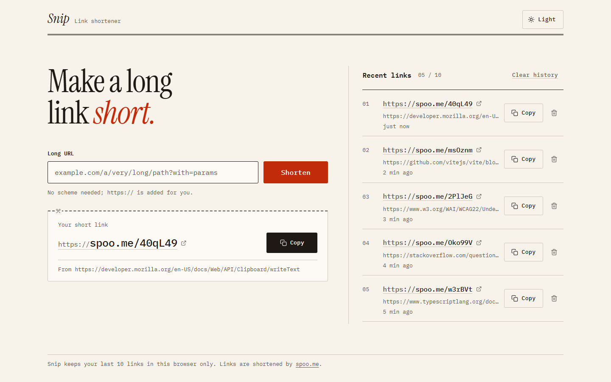
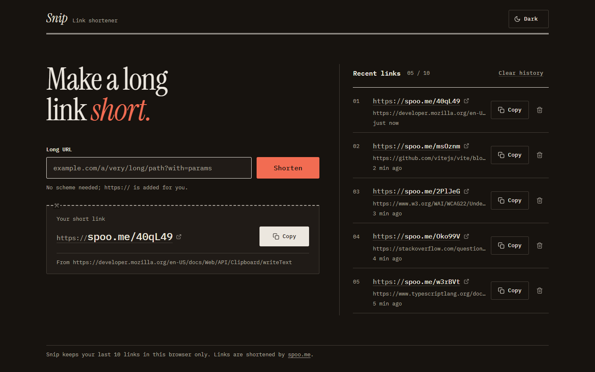

# Snip

A small, carefully made URL shortener. Paste a long link, get a short one, copy it, and find it again later.

Vanilla TypeScript on Vite. No UI framework, no CSS framework, no runtime dependencies, no backend.





## Features

- **Shorten in one step.** Paste a URL and press Enter. `https://` is added when you leave it off, and surrounding spaces are trimmed.
- **Copy with feedback.** The Copy button confirms with a check mark for 1.5 seconds. If the browser blocks the clipboard, Snip selects the link and asks you to press Ctrl+C.
- **Recent links.** The last 10 links are kept in your browser (`localStorage`), newest first, with relative times, Copy and Delete. Shortening a URL that is already in your history reuses its short link without calling the API.
- **Clear errors.** Invalid input, links that are already short, rate limits, offline and timeouts each get a plain-language message.
- **Light, dark and system themes.** The header toggle cycles System, Light and Dark. The choice is remembered, applied before first paint (no flash), and System follows OS changes live.
- **Accessible by default.** WCAG 2.2 AA contrast in both themes, full keyboard use, visible focus rings, live-region announcements, and `prefers-reduced-motion` support.

## Getting started

You need [Node.js](https://nodejs.org/) `20.19+` or `22.12+`.

```bash
npm install
npm run dev
```

Open the local URL Vite prints (usually http://localhost:5173/).

| Script | What it does |
|---|---|
| `npm run dev` | Start the dev server |
| `npm run build` | Type-check with `tsc`, then build to `dist/` |
| `npm run preview` | Serve the production build locally |

## How it works

Links are shortened by [spoo.me](https://spoo.me), a free API that needs no key:

```http
POST https://spoo.me/
Accept: application/json
Content-Type: application/x-www-form-urlencoded

url=https%3A%2F%2Fexample.com%2Fa%2Fvery%2Flong%2Fpath
```

The response is checked with a type guard, and the returned `http://` short link is rewritten to `https://`. Requests time out after 10 seconds.

> [!NOTE]
> spoo.me allows roughly 5 new links per minute. When you hit the limit, Snip says so and asks you to wait a moment. Links already in your history don't count, because they never reach the API.

> [!IMPORTANT]
> History lives only in this browser's `localStorage`. Clearing site data, or switching browsers, starts you with an empty list. The short links themselves keep working.

## Project structure

```text
index.html        Page shell and the inline no-flash theme script
src/
  main.ts         UI wiring: form, result, history, copy, announcements
  api.ts          Input validation and the spoo.me request
  history.ts      Reading and writing the recent-links list
  theme.ts        System / Light / Dark toggle
  icons.ts        Inline SVG icons
  types.ts        Shared types
  styles.css      Design tokens and all styles
```

## Design

The visual direction is a print-shop ledger: warm paper, ink-black type, one vermilion accent and hairline rules. Instrument Serif is used for the wordmark and the single headline; IBM Plex Mono carries everything else. Each result is a tear-off ticket, and history is a numbered index.

Every colour is an OKLCH custom property (`--bg`, `--surface`, `--ink`, `--accent`, and so on). Dark mode overrides only those tokens, so a component never needs its own theme rules. Motion stays between 150 and 250 ms with ease-out curves and turns off under reduced motion.

User and API data are only ever set through `textContent`, and only `http:` or `https:` URLs are placed in `href` attributes.

## Built with Cursor

Snip was built with Cursor's Agent from a plain-English brief, guided by project Agent Skills:

- **frontend-design** for the visual direction, typography and colour
- **emil-design-eng** for interaction details and motion
- **impeccable** for a final polish pass

After the first build, iterations added the theme toggle, fixed a clipboard-fallback bug (a stale "Press Ctrl+C" hint and selection could survive a later copy), and tightened copy, labels and states.
